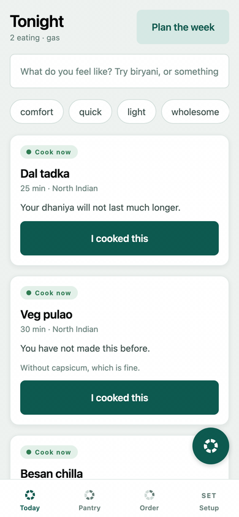

# Kokum

Recipe apps tell you to cook something and halfway through you find you are out of paneer, so Kokum tracks what is actually in your kitchen and only promises dishes it can back.

**Live demo:** https://kokum-six.vercel.app (runs in your browser; your pantry is saved on this device; AI ranking needs your own Claude key in Settings)



> [!NOTE]
> **Evals: the two model calls, before and after the fix**
>
> | Measure | Before fix | After fix |
> |---|---|---|
> | Grocery lists parsed fully correct | 20 / 20 | **20 / 20** |
> | Invented recipe ids reaching the user | 0 | **0** |
> | Dish sentences naming an ingredient the dish does not use | 3 / 80 | **0 / 80** |
> | Cook-now dishes kept first even if the model reorders them | No | **Yes, enforced in code** |
>
> Fictional data run through the Claude Code CLI, not the production API path; the sentence rule was tuned on the same 80 sentences it is scored on. Method and every miss: [EVALS.md](EVALS.md).

## Why AI here, why code there

| Step | Done by | Why |
|---|---|---|
| Read a bill, list or shelf photo, or a spoken list, into pantry lines | Model (`app/src/ai/parse.ts`) | Handwriting, Hinglish and messy invoices are a language problem. Code then drops any ingredient id not in the dictionary, and a person confirms every line. |
| Decide Cook now, Need N items or Check first | Code (`app/src/engine/dishState.ts`) | A wrong answer sends you to the stove without paneer. It must be deterministic and tested. |
| Diet, allergy, cooktop and fasting filters; depletion and scaling | Code (`app/src/engine/`) | Hard rules and arithmetic are never a judgment call. |
| Order the shortlist and write one sentence per dish | Model (`app/src/ai/rerank.ts`) | Tone and context are what a model is good at. Code drops any recipe id the model invents, re-adds any dish it skipped, and reattaches the state this device computed. |

## Quick start

```bash
cd app
npm install
npm start          # then scan the QR with Expo Go
```

Optional: paste a Claude API key in Setup to turn on photo and voice capture. Optional: add
Supabase credentials to `.env` (see `.env.example`) to share a pantry across phones. Neither
is needed for the app to work.

## More

- [How it works](docs/how-it-works.md): the one rule, how it knows, getting groceries in, sharing a pantry, design
- [Status and known gaps](docs/status.md): pre-release status and what is not proven yet
- [Development](docs/development.md): verify commands, current test status, repo layout
- [Product brief](docs/PRD.md) · [Evals](EVALS.md) · [Decisions](DECISIONS.md) · [Agent rules](AGENTS.md)
- [AI engine](AI-ENGINE.md) · [Inventory model](INVENTORY.md) · [Data model](DATA-MODEL.md) · [Integrations](INTEGRATIONS.md)
- [MIT License](LICENSE)
